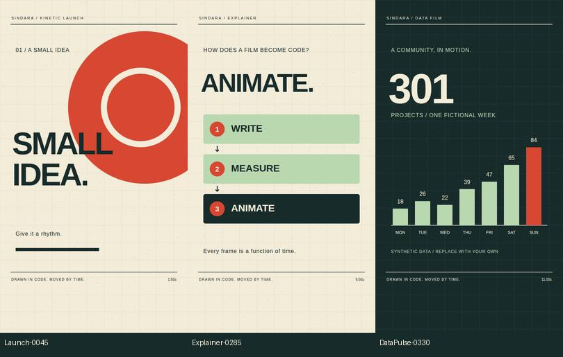

# Sindara Studio

**An agent-guided video production toolkit built on Remotion.**

Make short videos from React and SVG, with explicit timelines, reusable scene helpers, procedural sound, and a workflow for reviewing what you render. Use it yourself or give the included skill to a coding agent.



[](https://github.com/shivasaini04/sindara-open/actions/workflows/check.yml)
[](LICENSE)

## Start with a render

You need **Node.js 22+**, npm, and an internet connection for dependency installation and the first Chrome Headless Shell download. No API key, Python installation, paid model, or downloaded media is required for the three starter films.

```bash
git clone https://github.com/shivasaini04/sindara-open.git
cd sindara-open
npm ci
npm run doctor
npm run studio
```

Choose **Launch**, **Explainer**, or **DataPulse** in the preview. To write an MP4:

```bash
npm run render
```

The result is `out/launch.mp4`: a silent, 12-second, 1080×1920 short at 30 fps. The demos intentionally start silent so your first render needs only JavaScript dependencies. A first render can take longer while Chromium downloads; subsequent renders reuse it.

`remotion.config.ts` selects BT.709 and yuv420p for consistent video exports. The CLI currently prints an expected Zod version warning because this release pins a security-patched transitive dependency; see the [dependency note](docs/tools.md#dependency-warning).

```bash
npm run render:explainer
npm run render:data
npm run stills -- Launch 0 120 240
```

The render commands use two workers. On a machine with only one CPU core, use `npx remotion render src/index.ts Launch out/launch.mp4 --concurrency=1 --pixel-format=yuv420p`.

## What can you make?

- Product launch shorts and release announcements with kinetic type.
- Technical and educational explainers with diagrams and timed reveals.
- Animated data stories using your own JSON or a dataset you may redistribute.
- Custom graphic shorts built by extending the scenes and agent workflow.

Sindara is for people comfortable editing code or working with a coding agent. The source is the project: change the words, shapes, timing and data, then rerender. It is an early toolkit, not a visual video editor or a one-prompt filmmaking service.

## Three small, complete examples

| Composition | Starting point | Edit |
| --- | --- | --- |
| `Launch` | Oversized type, three cuts, moving graphics | [`src/productions/launch.tsx`](src/productions/launch.tsx) |
| `Explainer` | A three-step diagram driven by event timestamps | [`src/productions/explainer.tsx`](src/productions/explainer.tsx), [`timing.json`](src/productions/timing.json) |
| `DataPulse` | A count-up and staggered weekly bar chart | [`src/productions/data-pulse.tsx`](src/productions/data-pulse.tsx), [`data.json`](src/productions/data.json) |

The data example uses explicitly **synthetic data**. All three are code-drawn, use system fonts, and contain no AI-generated images, third-party songs, or private production assets. [Example walkthroughs →](docs/examples.md)

## Make your own

```bash
npm run new -- MyFilm
```

This copies the launch starter into `src/productions/MyFilm/` and creates a production brief. It prints the import and `<Composition>` to add to `src/Root.tsx`; registration is deliberately explicit. Existing folders are never overwritten.

Edit `Film.tsx` and `BIBLE.md`, register the composition, then:

```bash
npm run typecheck
npm run stills -- MyFilm 0 120 240
npx remotion render src/index.ts MyFilm out/my-film.mp4 --concurrency=2 --pixel-format=yuv420p
```

Every scene should be a pure function of time. Frames can render in parallel and out of order. [`src/lib/time.js`](src/lib/time.js) provides clamped interpolation and keyframes; [`Stage.tsx`](src/lib/Stage.tsx) provides the starter palette, SVG stage and deterministic paper marks.

## Use with a coding agent

The project includes [`AGENTS.md`](AGENTS.md) and [`skills/code-video-studio/SKILL.md`](skills/code-video-studio/SKILL.md). Open the repository in your coding agent and point it to those files. Agents that discover skills differently can read the skill by path; no global installation is required.

Example request:

> Read the code-video-studio skill. Make a 20-second vertical explainer about how a cache works. Use a paper-and-ink palette, one visual idea per shot, and no paid AI services. Show me three style frames before the full render.

The workflow is: **brief → timeline → style frames → scenes → sound → render → review**. The goal is to make the production decisions explicit, so both people and agents can iterate on them. [Full workflow →](docs/workflow.md)

## Add sound and production tools

The optional Python tools come from Sindara's internal production workflow: procedural paper/cloth/ink textures, synthesized sound effects, cue-sheet mixing with voice ducking, video linting, contact sheets, captions, and audio mux verification.

Use **Python 3.11+**. Create a virtual environment and install only what you need:

```bash
python -m venv .venv
# macOS/Linux: source .venv/bin/activate
# Windows PowerShell: .venv\Scripts\Activate.ps1
python -m pip install -r requirements.txt
```

On systems where Python is named `python3`, use `python3` to create the environment. Linux distributions may require their `python3-venv` package. Install **FFmpeg and ffprobe on PATH** for mixing compressed media, muxing and video linting. Remotion's own bundled encoder is sufficient for the JavaScript-only demos.

Create a sample soundtrack using Python's standard library, then mux it onto the explainer:

```bash
npm run render:explainer
python scripts/demo_audio.py --out public/local/demo.wav
python scripts/render_and_verify.py --video out/explainer.mp4 --audio public/local/demo.wav --out out/explainer-audio.mp4
python scripts/qa_lint.py --video out/explainer-audio.mp4
python scripts/captions.py src/productions/timing.json out/explainer.srt
```

The synthesized score and the explainer use the same event timestamps. The mux check measures **supplied audio vs output audio offset**; it does not prove that every visual action matches a sound. Texture, pacing and flash checks are heuristics, not aesthetic or accessibility certification. [Tool commands and limitations →](docs/tools.md)

## Optional AI review

`scripts/review.py` can send a frame, audio file, or compressed video to Gemini for feedback. Nothing in setup, demos, tests or CI makes paid AI calls.

1. Install `requirements-ai.txt`.
2. Copy `.env.example` to `.env` and set your own `GEMINI_API_KEY` and `GEMINI_MODEL`.
3. Set a budget and supply a conservative per-call estimate. Choose a model available to your account; availability and pricing vary.

```bash
python -m pip install -r requirements-ai.txt
python scripts/review.py --kind frame --input out/stills/Launch-0000.png --brief "Kinetic launch poster" --estimate-usd 0.10
```

**The input media, reference if supplied, and brief are uploaded to Google.** The local ledger tracks your estimates, not actual provider charges, and cannot enforce a provider-side spending cap. Failed attempts remain reserved. AI findings require human verification. [Configuration and privacy →](docs/tools.md#optional-ai-review)

## Scope and roadmap

Version 0.1 extracts a small reusable toolkit from a larger private studio. It includes three working starters, shared timing/stage helpers, the agent workflow, offline production scripts, and optional AI review.

It does **not** include story canon, customer work, private reference media, a unified animation engine, character rigs, forced word alignment, lip-sync, TTS, AI image/video/music generation, or hosted rendering. Those features should not be inferred from the original studio's experiments.

Next priorities: more reusable camera/type helpers, stronger audio workflows, additional cleared examples, and regression stills. [Roadmap →](docs/roadmap.md)

## Development and contributing

```bash
npm ci
npm run check
python -m pip install -r requirements.txt
python -m unittest discover -s tests
```

CI checks JavaScript on Linux, macOS and Windows and runs render/audio smoke checks on Linux. See [CONTRIBUTING.md](CONTRIBUTING.md) for changes and [SECURITY.md](SECURITY.md) for private vulnerability reporting. Useful contributions include a reproducible first-render bug, a portable tool fix, or a small example with clear asset rights.

## License and credits

Sindara's original code, documentation, synthetic data and procedural demo artwork are released under the [MIT license](LICENSE), copyright Shiva Saini. This repository has fresh history and excludes the private studio workspace.

**Remotion retains its own license.** Its free-use eligibility and company licensing requirements still apply; Sindara's MIT license does not relicense Remotion or other dependencies. Read the [Remotion license](https://github.com/remotion-dev/remotion/blob/main/LICENSE.md) and [dependency notices](THIRD_PARTY_NOTICES.md). Asset provenance is recorded in [ASSETS.md](ASSETS.md).
